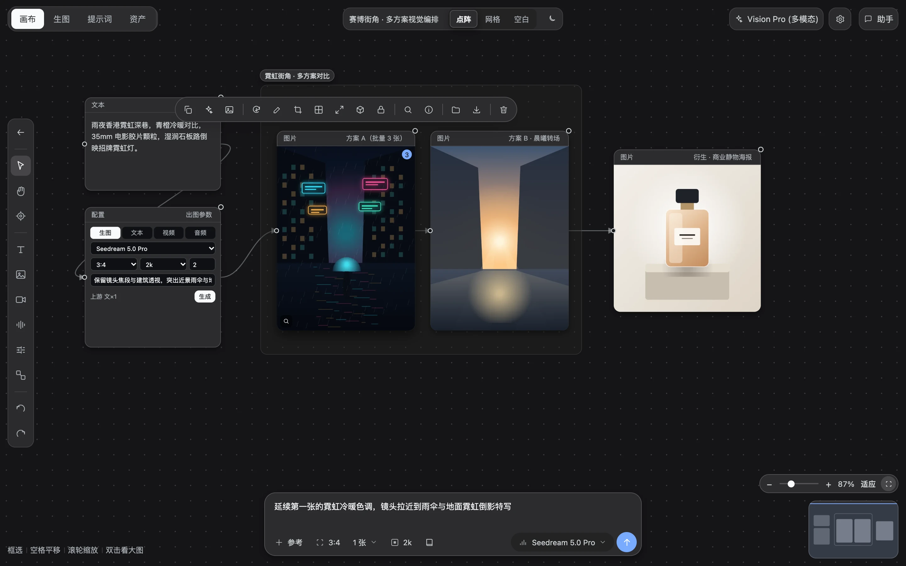
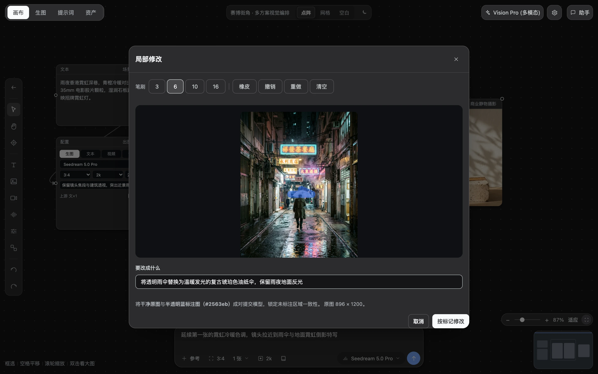
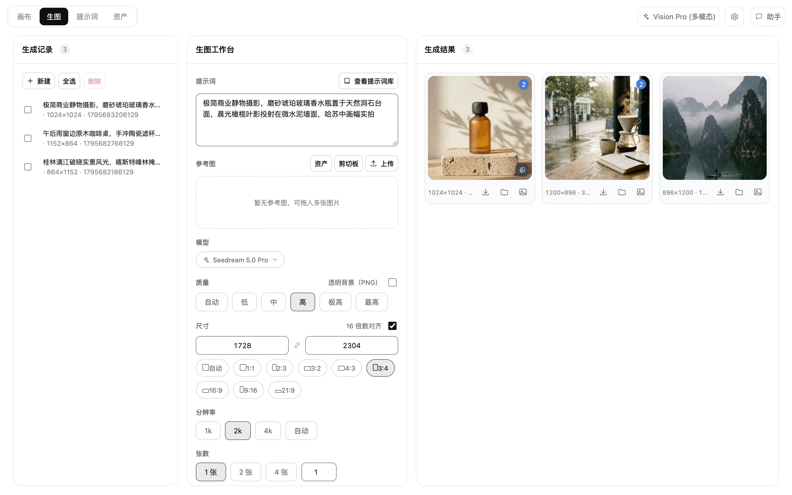
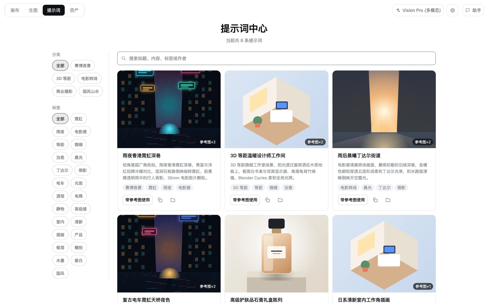
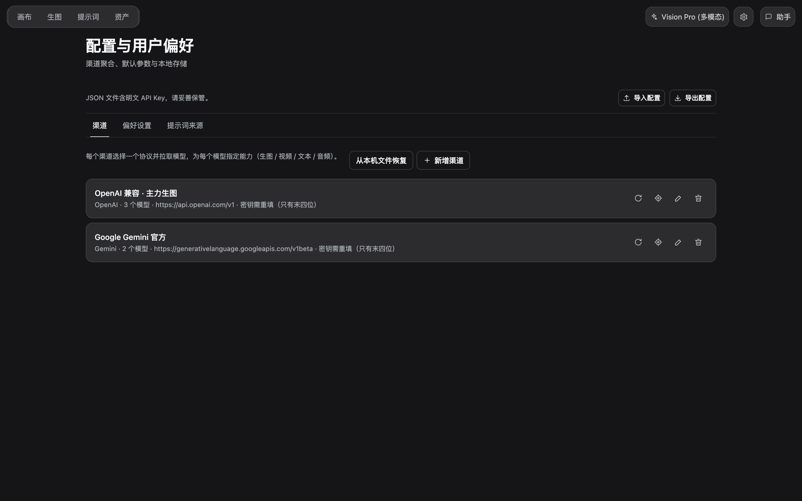

# 春风画布（`dsh-chunfeng-image`）

> A node-based infinite canvas plugin for **DSH (DeepSeek Shell)** — AI image generation, visual workflow orchestration, local image tools, prompt library, and asset management.

春风画布是面向 DSH 的无限画布 AI 创作插件，将节点式画布编排、多协议模型中转、独立生图工作台（Studio）、社区提示词库与本地资产管理整合在同一个工作区中。



## 核心特性

- **无限画布（Infinite Canvas）**：支持多画布管理、节点式 AI 出图与连线编排、分组、撤销/重做历史、网格背景与视口裁剪（500+ 节点流畅交互）。
- **15 项图片节点工具**：悬停工具条提供完整图片操作——复制提示词、反推提示词、送去工作台、替换图片、局部修改、裁剪、切图、放大、多角度、等比/自由缩放切换、看大图、信息查看、存为资产、下载与删除。
- **蒙版局部重绘（Mask Inpainting）**：内置画笔/橡皮擦蒙版绘制，配合提示词对画面局部进行重绘编辑。
- **提示词反推（Prompt Reverse-Engineering）**：调用多模态视觉模型从画布图片反推可用提示词。
- **批量图片组（Batch Image Groups）**：一次生成多张图片时自动成组排列，方便横向对比与筛选。
- **OpenAI / Gemini 多协议中转**：通过 DSH 插件 Host `/relay` 同源转发上游接口，绕开浏览器 CORS 限制，支持在线拉取模型列表与多渠道自由切换。
- **Studio 双向工作流**：独立生图工作台与无限画布双向联动，支持将画布节点一键送入工作台继续编辑，或把工作台生成结果直接发送到画布。
- **7 个内置提示词源**：聚合社区提示词库，内置 60 秒超时保护、GitHub Raw + jsDelivr 镜像对冲加速，支持封面图与参考图代理加载。
- **本地 JSON 资产导入**：支持从本地选择 JSON 文件导入单条资产、资产数组或导出备份中的 `assets` 列表。
- **安全 ZIP 备份与恢复**：一键打包导出/恢复画布与本地媒体文件，导出时自动剥离所有明文 API Key。
- **深色 / 浅色主题**：基于 DSH 设计令牌，自动跟随宿主深浅色外观切换。

## 界面导览

插件支持暗黑与明亮双主题无缝切换，以下为各核心模块实际界面预览：

### 1. 无限画布与节点工作流编排（暗色外观）

支持文本设定节点、交互式配置节点与图片/批量图组节点的连线编排与下游派生；悬停任意图片节点可呼出 15 项专业图片工具条，底部一体式输入条支持引用参考图、比例像素锁定、张数与分辨率调节。


### 2. 蒙版局部重绘（Mask Inpainting）

在图片节点工具条中点击「局部修改」，即可使用内置半透明蓝色画笔/橡皮擦精准涂抹待修改区域，输入局部重绘提示词后提交上游 `/images/edits` 自动生成对比新节点。



### 3. Studio 独立生图工作台与画布互送（浅色外观）

三栏式生图工作台聚合历史生成记录（持久化至 IndexedDB）、参数表单与参考图顺序管理、以及右侧多图结果画廊，支持单槽重试与一键「送到画布」双向流转。



### 4. 提示词中心与参考图联动（浅色外观）

内置 7 个社区官方提示词源（支持 `github.com/blob` 自动转直链及 jsDelivr 镜像对冲加速），以 4:3 视觉封面墙展示提示词、参考图数量角标及分类/多标签筛选，点击「带参考图使用」可自动下载配套参考图并直达工作台或画布。



### 5. 多协议渠道与来源管理（暗色外观）

统一管理 OpenAI 兼容与 Google Gemini 官方渠道，支持在线拉取模型清单与连通性诊断；本地配置文件与备份强制 `0600` 权限保存，并支持配置 JSON 导入导出与「从本机文件恢复」自愈。



## 环境要求与安装

- **Node.js**：`>= 20`
- **DSH**：`>= 0.2.1-rc.5 < 0.3.0`

### 在 DSH 中安装使用

1. 克隆仓库并构建客户端产物：

```bash
git clone https://github.com/chunfengbuyu000/dsh-chunfeng-image.git
cd dsh-chunfeng-image
npm install
npm run build
```

2. 将插件包安装或软链至 DSH 插件目录（如 `~/.dsh/profiles/desktop/node_modules/dsh-chunfeng-image`），并在 DSH 配置中启用 `dsh-chunfeng-image`，重启 DSH 即可在侧栏/应用入口打开「春风画布」。

### 渠道配置

1. 点击顶栏右侧齿轮进入 **「配置」** 页。
2. 新增渠道，选择 **OpenAI 兼容** 或 **Gemini** 协议，填写 **Base URL** 与 **API Key**。
3. 点击 **拉取模型** 获取上游可用模型列表（支持直接用输入框中的新 Key 拉取），勾选并启用需要的生图/多模态模型。
4. 在默认模型设置中选择常用生图模型与尺寸，返回画布或生图工作台即可开始创作。

## 开发与测试

```bash
# 构建前端产物（输出至 dist/client.js）
npm run build

# 监听模式构建
npm run watch

# 运行纯 Node 单元测试（含 Host 路由与安全测试，无需浏览器）
npm run test:unit

# 运行全量测试（包含基于 Puppeteer 的存储、生成链路与 E2E 回归）
# 若项目未直接安装 puppeteer / puppeteer-core，可通过 PUPPETEER_DIR 指定所在目录
PUPPETEER_DIR=/path/to/puppeteer-dir npm test

# 如需指定 Chrome / Chromium 路径，可额外设置 CHROME_PATH
CHROME_PATH="/Applications/Google Chrome.app/Contents/MacOS/Google Chrome" PUPPETEER_DIR=/path/to/puppeteer-dir npm test

# 运行 500 节点画布性能与视口裁剪基准测试
PUPPETEER_DIR=/path/to/puppeteer-dir npm run test:perf

# 重新生成 README 界面截图（输出至 assets/screenshots/）
PUPPETEER_DIR=/path/to/puppeteer-dir npm run shot:readme
```

> 浏览器测试脚本通过 `scripts/puppeteer-loader.mjs` 统一解析 `puppeteer-core` / `puppeteer` 与本地 Chrome/Chromium；当运行环境缺少 Puppeteer 或浏览器时，浏览器测试会打印提示并优雅跳过。

## 安全与本地隐私

- **配置文件权限**：Host 侧本地配置镜像保存在 `~/.dsh/dsh-chunfeng-image/config.json`，写入时强制使用 `0600` 权限（仅当前系统用户可读写）。
- **备份脱敏**：ZIP 备份导出只包含画布结构、提示词、资产与媒体文件，**不包含任何明文 API Key**。
- **Host 路由鉴权**：插件注册的所有 `/dsh-chunfeng-image/*` 路由均经由 DSH 宿主鉴权拦截，未授权访问返回 `401`。
- **SSRF 防护**：Host 的 `/fetch` 与 `/fetch-media` 代理接口禁止访问云元数据与链路本地地址（包括 `169.254.0.0/16`、`100.100.100.200`、`metadata.google.internal`、`metadata.goog`、`metadata.azure.internal` 以及 IPv6 `fe80::/10` 链路本地与 IPv4 映射地址），同时保留 `/relay` 对本地推理服务（如 ComfyUI / Ollama）的访问能力。

## 已知限制

- **视频生成**：依赖上游渠道实际支持 OpenAI 兼容的 `/videos` 接口；若上游不支持，插件会提示当前渠道不支持视频生成。
- **音频节点**：画布工具栏保留了音频节点入口作为占位，当前尚未接入上游音频生成 API，暂不支持生成。
- **图片放大（Upscale）**：当前基于浏览器本地 Canvas 插值缩放实现，并非 AI 超分辨率模型。
- **界面语言**：目前 UI 文案以中文为主（Chinese-first）。

## 致谢

- 画布交互与功能设计参考并移植自开源项目 [basketikun/infinite-canvas](https://github.com/basketikun/infinite-canvas)（MIT License）。
- 内置提示词源数据来自社区提示词仓库 [yukkcat/image-prompts](https://github.com/yukkcat/image-prompts)。

## License

[MIT](./LICENSE)
